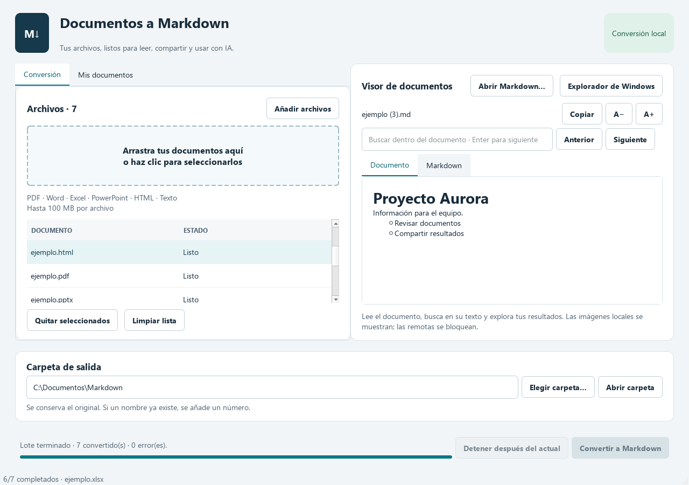
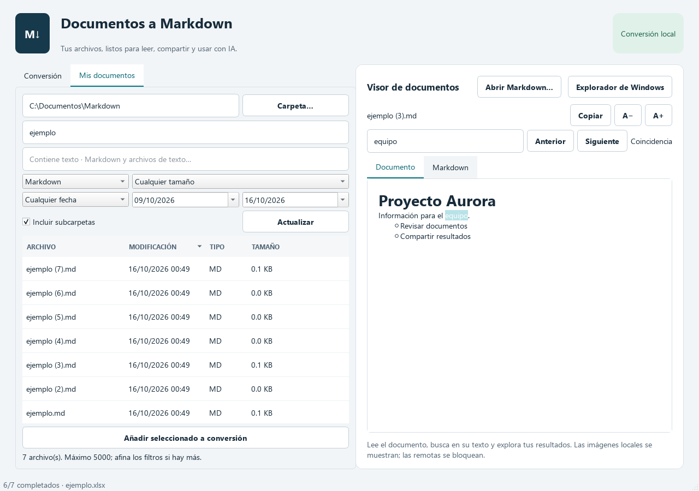

# MarkItDown ES

Una aplicación de escritorio para convertir documentos a Markdown en Windows, con una interfaz en español. Basada en [Microsoft MarkItDown](https://github.com/microsoft/markitdown); proyecto independiente, sin afiliación ni patrocinio de Microsoft.

**Versión 1.1:** visor de documentos con búsqueda y zoom, biblioteca con filtros por nombre/tipo/tamaño/fechas, búsqueda dentro de archivos de texto, apertura con doble clic y motor reutilizable para acelerar lotes.

En la prueba local del ejecutable con siete archivos pequeños, la mediana bajó de **13,10 a 2,47 segundos**. Consulta [la medición y sus límites](docs/RENDIMIENTO.md).





## Descargar y abrir en Windows

1. Abre [la última versión](https://github.com/viccentebb-eng/markitdown-es/releases/latest).
2. Descarga **MarkItDown-ES-Windows-x64.zip** y extrae **toda la carpeta**.
3. Abre `MarkItDown-ES.exe` dentro de la carpeta extraída. No requiere Python ni Office.
4. Arrastra archivos a la ventana o pulsa **Añadir archivos**. Puedes seleccionar varios.
5. Selecciona la **carpeta de salida** y pulsa **Convertir a Markdown**.
6. Selecciona un resultado para leerlo, ver su código o copiar el Markdown completo.

Para abrir `.md` con doble clic y tener acceso directo en el escritorio, ejecuta **Instalar-MarkItDown.cmd**. Para la vista previa dentro del Explorador de Windows se utiliza el proyecto existente **Microsoft PowerToys**. Consulta la [guía de integración con Windows](docs/EXPLORADOR.md).

Requisitos: Windows 10/11 de 64 bits. El ejecutable portable no tiene firma digital; Windows puede mostrar una advertencia de editor desconocido. Verifica el origen y la suma SHA256 publicada antes de abrirlo. La carpeta `_internal` debe permanecer junto al ejecutable.

Si todavía no hay una release, descarga el artefacto del último [flujo de Windows completado](https://github.com/viccentebb-eng/markitdown-es/actions). Los artefactos de Actions requieren iniciar sesión y caducan a los 30 días; las releases conservan la descarga.

## Qué incluye

- Arrastrar y soltar archivos locales y selección múltiple con `Ctrl+O`.
- Cola por lotes, estado por documento, progreso por archivos terminados y errores legibles.
- Vista previa del documento y del código Markdown; copia del resultado completo.
- Apertura directa de archivos Markdown sin convertirlos, búsqueda dentro del documento con Ctrl+F y zoom.
- Biblioteca **Mis documentos** con búsqueda por nombre, tipo, tamaño, fecha de modificación e intervalos; orden por columnas y subcarpetas.
- Búsqueda de contenido en Markdown y texto, sin distinguir acentos ni mayúsculas, en segundo plano.
- Selector de carpeta de salida y botón para abrirla. Recuerda la última carpeta elegida.
- Conserva los originales y los resultados existentes: `informe.md`, `informe (2).md`, etc.
- **Detener después del actual** termina el documento en curso y deja el resto pendiente.
- Los archivos correctos permanecen listos; volver a convertir reintenta los fallidos y pendientes.

## Formatos y límites

PDF con texto, DOCX, PPTX, XLSX, XLS, HTML/HTM, TXT, Markdown, CSV, JSON, XML y EPUB. Límite de conversión: **100 MB por archivo**. El visor muestra documentos de texto completos de hasta **10 MB**, sin el antiguo recorte de 200 000 caracteres. Las imágenes locales se restringen a la carpeta del documento y sus subcarpetas; no se cargan imágenes de internet.

Esta edición no incluye OCR para escaneos, transcripción de audio, imágenes con IA, archivos ZIP, URLs ni servicios de nube. Un PDF sin texto muestra un error de OCR; los diseños complejos pueden perder formato. Un archivo corrupto o protegido puede fallar sin detener los demás. No se abren enlaces externos automáticamente dentro del visor.

La aplicación llama a `MarkItDown.convert_local()` con plugins desactivados. TXT y Markdown tienen una ruta directa que conserva su texto sin cargar el modelo de detección. No configura clientes de IA, telemetría ni subida de documentos. La conversión se ejecuta con los permisos de tu usuario: abre documentos de confianza; la aplicación no es una zona aislada para archivos hostiles. Un proceso hijo reutiliza el motor entre documentos y lotes, manteniendo la interfaz separada de fallos nativos; se reinicia tras un cierre y se apaga después de un minuto inactivo. El lote es secuencial y la detención espera al documento actual. Cada conversión tiene un límite de cinco minutos.

## Ejecutar desde el código

Instala Python 3.13 de 64 bits y Git. En PowerShell:

```powershell
git clone https://github.com/viccentebb-eng/markitdown-es.git
cd markitdown-es
py -3.13 -m venv .venv
.\.venv\Scripts\python.exe -m pip install -r requirements.lock
.\.venv\Scripts\python.exe -m pip install --no-deps -e .
.\.venv\Scripts\python.exe -m markitdown_es
```

No es necesario activar el entorno ni cambiar la política de ejecución de PowerShell.

## Pruebas y empaquetado

```powershell
.\.venv\Scripts\python.exe -m ruff check .
.\.venv\Scripts\python.exe -m pytest -q
.\.venv\Scripts\python.exe -m pip_audit --disable-pip --no-deps -r requirements.lock
powershell -NoProfile -ExecutionPolicy Bypass -File scripts/build.ps1 -Python .\.venv\Scripts\python.exe
```

El último comando aplica la política solo a ese proceso de construcción. Genera `dist/MarkItDown-ES-Windows-x64.zip`, que contiene el `.exe`, sus bibliotecas y los avisos de licencia. Se usa una carpeta portable para conservar las bibliotecas Qt reemplazables y evitar extraer cientos de megabytes en cada inicio.

El flujo de GitHub Actions instala versiones fijadas, revisa el código, convierte siete documentos de prueba, audita dependencias, construye el `.exe` y prueba **el ejecutable construido** con esos documentos. Cada ejecución correcta entrega ZIP, SHA256, informe y captura. Un tag `v*` publica una release únicamente después de superar esas comprobaciones:

```powershell
git tag v1.1.0
git push origin v1.1.0
```

Las muestras son sintéticas y se regeneran con `python scripts/make_fixtures.py`. No incluyen datos del usuario. Consulta [la validación](docs/VALIDACION.md) y [los componentes de terceros](THIRD_PARTY.md).

## Licencia

Código propio bajo MIT. MarkItDown se distribuye bajo MIT. Qt/PySide6 y los demás componentes conservan sus propias licencias; consulta `THIRD_PARTY.md` y los avisos incluidos en `_internal`.
